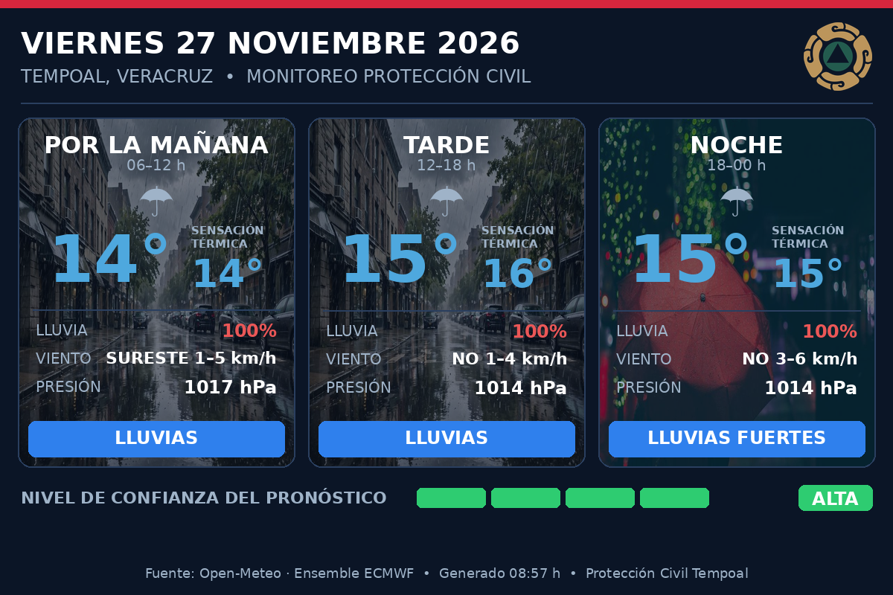

<div align="center">
  

  # 🌤️ Clima Tempoal

  ### El clima de Tempoal, explicado como debe ser: claro, a tiempo y sin vueltas.

  *Reporte diario para Protección Civil de Tempoal, Veracruz.*

  
  
  
</div>

---

## ☀️ ¿Qué es esto?

Un bot que cada mañana prepara el pronóstico de Tempoal y lo manda al canal de Telegram de Protección Civil. Sin apps, sin vueltas: la tarjeta, el texto y, en temporada, la gráfica de frío para Navidad.

La idea es simple: **que cualquier persona entienda el clima de hoy**, no solo quien sabe leer un mapa de modelos.

---

## 🖼️ Así se ve el reporte

<div align="center">
  
</div>

*La tarjeta diaria: mañana, tarde y noche, con temperatura, sensación térmica, lluvia, viento, presión y el nivel de confianza del pronóstico.*

---

## 💌 ¿Qué llega cada mañana?

- 🖼️ **La tarjeta diaria** — el pronóstico en una imagen: por la mañana, tarde y noche, con fotos del cielo según el clima.
- 📝 **El texto del reporte** — resumen ejecutivo, condiciones actuales con viento, el pronóstico hora por hora, los próximos 3 días, el panorama de la semana y las estadísticas semanales.
- 📅 **La semana en Tempoal** — un panorama narrado de lo que viene en la semana, escrito con ayuda de Gemini.
- 🎄 **¿Frío en Navidad?** — en temporada, una gráfica con la probabilidad de mínima fría rumbo al 25 de diciembre.
- 📊 **Confianza real** — la lluvia y la confianza no son un cálculo del bot: se miden con el ensemble de ECMWF, el mismo modelo corrido 51 veces para ver en qué coinciden sus miembros.
- 📢 **Alertas** — si hay algún evento meteorológico en las próximas 24 horas, el reporte lo avisa.

---

## 🧭 ¿Cómo funciona?

1. 🌍 **Se consultan los datos** — Open-Meteo trae el pronóstico para Tempoal (modelos ECMWF y GFS) y sus ensembles.
2. 🎨 **Se arma la tarjeta** — con fotos reales del clima, colores según la temperatura y la lluvia, y el nivel de confianza.
3. ✍️ **Se escribe el reporte** — el texto interpreta los datos: solo aparece lo que cambia algo (el viento flojo no se menciona; si importa, se dice qué causa).
4. ✈️ **Llega a Telegram** — foto, texto y gráfica al canal de Protección Civil, cada mañana.

> Todo corre solo, una vez al día, con GitHub Actions. Si algo falla (por ejemplo, si Open-Meteo no responde), el bot lo registra y el reporte no sale a medias: o llega completo, o no llega.

---

<details>
<summary>🔧 Para los curiosos: el detalle técnico</summary>

<br>

**Tecnología:** Python 3.11 · Pillow (tarjetas y gráficas) · requests · GitHub Actions · API de Telegram · Gemini 2.5 Flash (narrativa semanal, opcional)

**Estructura:**

```
├── main.py                     # El reporte de principio a fin
├── src/
│   ├── clima.py                # Datos de Open-Meteo + ensembles
│   ├── formato.py              # El texto del reporte
│   ├── interpretador.py        # El texto inteligente (qué se dice y qué no)
│   ├── narrador.py             # El panorama semanal con Gemini
│   ├── tarjeta.py              # La tarjeta diaria (imagen)
│   ├── grafica_navidad.py      # La gráfica de frío para Navidad
│   └── telegram_bot.py         # Envío a Telegram
├── assets/fondos/              # Fotos de los paneles de la tarjeta
├── scripts/prueba_privada.py   # Prueba todo sin enviar nada
└── tests/                      # Pruebas unitarias
```

**Probar sin enviar nada:**

```bash
python scripts/prueba_privada.py   # corre todo con datos reales, no manda nada
python -m unittest discover -s tests
```

**Variables de entorno:**

| Variable | Para qué | Obligatoria |
| :--- | :--- | :---: |
| `TELEGRAM_TOKEN` | El bot de Telegram | ✅ |
| `TELEGRAM_CHAT_ID` | El canal donde llega el reporte | ✅ |
| `GEMINI_API_KEY` | Las narrativas (Google AI Studio, gratis) | No — sin ella, el reporte sale igual pero sin esas secciones |
| `GROQ_API_KEY` | Respaldo de las narrativas si Gemini falla (Groq, gratis, sin tarjeta) | No — sin ella, el respaldo se omite y el reporte sale igual |

</details>

---

## 🤝 Créditos

- Datos del pronóstico: [Open-Meteo](https://open-meteo.com/) — modelos ECMWF (IFS) y GFS, ensembles ECMWF (51 miembros) y GFS (31 miembros).
- Fotos de los paneles: Openverse (CC) y material generado, con créditos en `assets/fondos/FUENTES.md`.
- Narrativas: Gemini 3.5 Flash-Lite (Google AI Studio), con respaldo Groq (GPT-OSS 120B).

---

<div align="center">

*Hecho para Tempoal, Veracruz — Protección Civil 🛡️*

</div>
